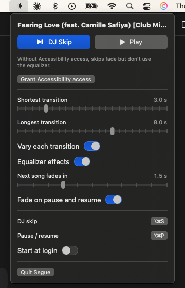

# Segue

A macOS menu bar app that makes skipping a song in Apple Music sound like a DJ transition.

Press a shortcut and, instead of cutting the song off, Segue fades it out while sweeping the equalizer, skips, and fades the next song in. Each skip uses a different combination of fade and filter, so no two sound the same. Afterwards your volume and equalizer go back to how you left them.

This is a personal proof of concept. It is a rough beta.



## How it works

Segue never touches the audio. It remote-controls the Music app that is already playing:

- **Volume, skip, play and pause** go through Music's scripting interface.
- **The filter sweep** moves the sliders in Music's own Equalizer window through the macOS Accessibility API. Segue opens that window from Music's menu and minimizes it to the Dock. If you already have it open, Segue leaves it where it is.

Each DJ skip picks a "recipe" at random:

| Part | Options |
|---|---|
| Length | Within the range you set (default 3–8 seconds) |
| Fade target | Down to 0%, 25%, 45% or 60% of your volume, then skip |
| Fade shape | Drops early, steady, or drops late |
| Equalizer focus | None, lows, mids, highs, or lows and highs |
| Equalizer depth | −6 to −12 dB |

The same equalizer focus and fade target never come up twice in a row.

## Requirements

- macOS 14 or later (built and tested on macOS 15)
- The Music app, with an Apple Music subscription or your own library
- Swift 6 toolchain. The Xcode Command Line Tools are enough; Xcode itself is not needed.

## Build and run

```bash
./scripts/build-app.sh
open build/Segue.app
```

Run the tests with:

```bash
swift test
```

The build is signed ad hoc by default, which means macOS asks for Segue's permissions again after every rebuild. To avoid that, create a local signing certificate once and rebuild:

```bash
./scripts/make-signing-cert.sh
```

That script has not been tested end to end yet. If it fails, the ad hoc build still works.

## Permissions

Segue asks for two permissions:

- **Automation (control Music):** macOS prompts the first time Segue talks to Music. Needed for everything.
- **Accessibility:** click "Grant Accessibility access" in Segue's panel. Needed for the equalizer sweep. Without it, skips still fade.

## Using it

| Shortcut | Action |
|---|---|
| ⌥⌘S | DJ skip |
| ⌥⌘P | Faded pause / resume |

Both work from any app and can be changed in the panel.

- **Hunting for a song:** press DJ skip again during a transition, or within 3 seconds of one, and it skips instantly. Skips stay instant until 10 seconds pass without one.
- **Your volume wins:** if you change the volume during a fade, Segue leaves it where you put it.
- **Music's own skip button and your keyboard's media keys** still skip instantly, as usual.

Settings in the panel: shortest and longest transition, vary each transition, equalizer effects, next-song fade-in, fade on pause and resume, the two shortcuts, and start at login.

## Known limitations

- Apple Music on macOS only.
- With AirPlay output, volume changes can be slow and stepped, so fades may sound rough.
- Music's own Crossfade setting is left alone.
- The equalizer sweep depends on the layout of Music's Equalizer window, so a macOS update that changes that window may break it. Skips then fall back to a plain fade.
- Music's equalizer only cuts a band by 12 dB, so the filter is gentler than a DJ mixer's.
- After a skip from a named equalizer preset, Music takes about half a second to slide back to that preset.
- The equalizer sweep expects macOS in English: it finds Music's Equalizer controls by their English names. In another language, skips fall back to a plain fade.
- If the Equalizer can't be reached when a skip ends, Segue puts it back before the next skip or pause instead.
- While the screen is locked, macOS hides Music's windows from Segue, so skips fade without the equalizer.
- The menu bar icon changes shape during a transition; it doesn't animate.
- "Start at login" only works from the packaged app, and may need the local signing certificate.

## Roadmap

- Demo video
- Transition log with replay and "never use this one again"
- Spotify support
- Tempo-matched transition timing
- Jump to the outro before fading
- Loops
- Better shuffle and an AI-music filter

## License

MIT. See [LICENSE](LICENSE).
